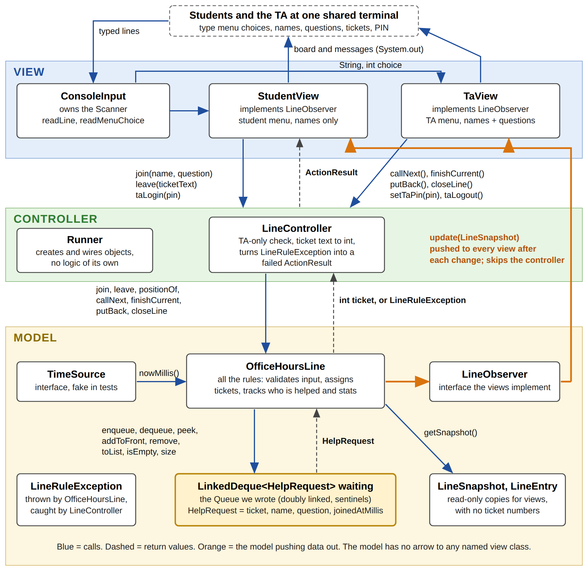

# Next Up

**CS 2114 Project 3, Group 93:** Aditya Banerjee, Nicolas Marchese, Al-Farouq Mohamed, Ha Minh Nguyen

Next Up is a terminal app for running an office-hours line on one shared laptop. Students join with their name and question, and get a private ticket number. They see their place in line and can leave early. The TA logs in with a PIN to call the next student, finish with them, or put them back at the front. When the TA closes the line, it shows how many students were helped and the average wait.

The line is a **queue we wrote ourselves**: `LinkedDeque<T>`, a doubly linked deque with sentinel nodes. The app follows **MVC**. The model (`nextup.model`) knows nothing about the controller or views and tells them about changes only through the `LineObserver` interface.



## Project layout

| Package | Classes | Role |
|---|---|---|
| `nextup.model` | `LinkedDeque<T>`, `HelpRequest`, `OfficeHoursLine`, `LineObserver`, `LineSnapshot`, `LineEntry`, `TimeSource`, `LineRuleException` | The line and all its rules. No view, no controller, no `System.out`. |
| `nextup.model` (test helpers) | `FakeTimeSource`, `RecordingObserver` | A clock tests set by hand, and an observer that counts updates. |
| `nextup.controller` | `LineController`, `ActionResult`, `Runner` | Carries actions to the model, owns TA login, wires the program. |
| `nextup.view` | `StudentView`, `TaView`, `ConsoleInput` | The terminal screens and the program's only `Scanner`. |
| `nextup.demo` | `ModelDemo` | Runs the model alone, with no view. |

## How to run

**Setup:** import this folder into Eclipse as an existing project. `CS2-Support` must be in the workspace, since it provides `student.TestCase` and JUnit.

### The model, with no view

- **Tests:** right-click `src/nextup/model`, then Run As → JUnit Test. `OfficeHoursLineTest`, `ModelTypesTest`, and `LinkedDequeTest` create no view, controller, or `Scanner`. `ModelBoundaryTest` reads the model's source files and fails if any of them imports `nextup.view` or `nextup.controller`, or uses `System.out`.
- **Driver:** run `src/nextup/demo/ModelDemo.java` as a Java Application. It walks the whole MVP path and five bad inputs against the model only, and prints the snapshot the model sends after each change:

```
> Ana, Ben, and Cal join
  now helping: nobody | waiting: 1.Ana(0m) 2.Ben(0m) 3.Cal(0m) | helped 0, avg 0.0 min
> Bad input: " ana " joins again
  refused: You're already in line at #1.
...
> Dee joins: Cal is ~4 min away, Dee ~8 (the wait-time estimate)
  now helping: nobody | waiting: 1.Cal(7m, est 4m) 2.Dee(0m, est 8m) | helped 1, avg 3.0 min
...
> TA closes the line
  now helping: nobody | waiting: | helped 3, avg 5.3 min | CLOSED
```

### The thin view

Run `src/nextup/controller/Runner.java` as a Java Application.

It runs on one laptop, with the student screen as the home screen. A sample run of the whole MVP path:

| Step | Type | You see |
|---|---|---|
| 1. The TA sets a PIN at startup | `1234` | `TA PIN set.` (a PIN that isn't 4 to 8 digits is asked for again) |
| 2. A student joins | `1`, then a name (`Ana`) and a question (`Recursion?`) | `You're #1. Your ticket is 6916.` The line shows `1. Ana (0 min)`, names only. |
| 3. The TA logs in | `3`, then `1234` | The TA menu. The TA line and questions appear after the next successful line action. |
| 4. Call the next student | `1` | `Now helping: Ana` |
| 5. Finish with them | `2` | `Finished helping the current student.` and `Helped: 1` |
| 6. Close the line | `4` | `The line is closed.`, then the final stats, and the program ends |

The active screen redraws the queue when the line changes. Before the first finished help session it shows “estimate after first student.” After a session, it shows an estimate such as “about 5 more.” A student can leave with `2` and their ticket number. The TA can put the current student back at the front with `3`, or log out with `5`. Ending input (Ctrl+D) stops the program cleanly from either screen.

### From a terminal, without Eclipse

```
cp <workspace>/CS2-Support/student.jar .
javac -d out -cp student.jar $(find src -name '*.java')
java -cp out nextup.demo.ModelDemo
java -cp out nextup.controller.Runner
java -Djava.security.manager=allow -cp out:student.jar org.junit.runner.JUnitCore \
  nextup.model.LinkedDequeTest nextup.model.OfficeHoursLineTest nextup.model.ModelTypesTest \
  nextup.model.ModelBoundaryTest nextup.controller.LineControllerTest \
  nextup.controller.BadInputTest nextup.view.ConsoleInputTest nextup.view.ViewTest
```

(`-Djava.security.manager=allow` is needed only on Java 18 or newer.)

**Build into `out`, not `bin`.** `bin` is Eclipse's folder. A terminal `javac` on a newer Java than Eclipse's writes class files Eclipse can't load, and Eclipse then fails with `UnsupportedClassVersionError` until you run Project → Clean.

## Reflection

*This is Deliverable 4. Our Deliverable 3 Reflection and Next Steps are kept at the end, under "Deliverable 3 record" (D3 was graded Exceeds).*

### How our design absorbed the change

**The change feature: wait-time estimates**, the one we named in D3. Each waiting student sees about how long until they're called: their position times the average length of a finished help session (from `callNext` to `finishCurrent`), rounded up to a whole minute. Until someone has been helped, there is nothing to base it on, so the estimate is `-1` and the screens say so.

**Prediction (D3) vs. what actually changed:**

| Class | D3 prediction | What actually changed | Matched? |
|---|---|---|---|
| `OfficeHoursLine` | Yes: field `totalHelpMillis`, `finishCurrent()` adds to it, new private `estimateMinutes(int)`, `getSnapshot()` passes it into each `LineEntry` | Exactly those four. Two small extras: the private helper `toEntry` takes the estimate as a parameter, and `putBack`'s Javadoc now says a put-back is not a finished session | ✅ |
| `LineEntry` | Yes: field `estimatedWaitMinutes`, constructor parameter, getter `getEstimatedWaitMinutes()` | Exactly those three. The constructor also rejects estimates below `-1` | ✅ |
| `StudentView`, `TaView` | Yes: print "about N min" or the no-estimate text | Both views display the estimate or the first-session message in `update`. The student screen displays names and the TA screen also displays questions. | ✅ |
| `LineSnapshot` | No | Unchanged. The estimate rides along inside each `LineEntry` | ✅ |
| `LineController`, `ActionResult` | No | No code changed. `git diff ca5c846 -- src/nextup/controller/LineController.java src/nextup/controller/ActionResult.java` shows only the filled-in LLM Statement in the header comment. The new `BadInputTest` drives the controller as it was, with no new method | ✅ |
| `LinkedDeque`, `HelpRequest`, `LineObserver`, `TimeSource`, `ConsoleInput`, `Runner` | No | Unchanged after the views were merged. `git diff ca5c846` on all six files shows no code change (only the header comments of `Runner` and `ConsoleInput`, and `ConsoleInput`'s `@author` line) | ✅ |

**Not in the prediction (what surprised us):**
- **`ModelTypesTest`:** adding one constructor parameter to `LineEntry` meant editing all **nine** existing `new LineEntry(...)` calls in this test. The prediction listed the new test cases but not this ripple.
- **`ModelDemo`:** we changed it to print the estimate, so the "model alone" demo shows the feature. It isn't part of the app, so the prediction didn't list it either way.
- **`StudentView`, `TaView`:** we expected to change only what the views displayed, but we also changed when they displayed it. Removing the cached snapshots meant rendering directly in `update()` and removing the separate Show the line option. This kept the views from storing a copy of the model's state.
- **`ViewTest` scripts:** the views moved TA login from student option `4` to `3` when Show the line was removed. Every scripted test that logged in as TA had to change its `4` to `3`. That is a view change rippling into view tests only, but the prediction didn't list it.
- **No surprise in the controller:** all 13 `BadInputTest` cases passed against the D3 controller on the first run. The estimate added no new way for input to go wrong that the controller had to catch.

### Did the change cross the model/view line?

The estimate is computed entirely in the model, in the private `estimateMinutes`. It reaches the views the same way every other number does: inside `LineEntry`, through `update(LineSnapshot)`. The views use no new import and call no new model method beyond one getter, and `ModelBoundaryTest` still passes. Both views render directly from the callback and retain no snapshot or queue data. The student view uses a local loop-exit flag set by the close notification. The views needed no other model API.

### What changed from our D3 plan

| D3 plan | What we did | Why |
|---|---|---|
| The plan didn't say what the student being helped shows | Their estimate is `0` | They aren't waiting anymore, and `-1` would wrongly say "no estimate yet" |
| "Rounded up to minutes" | Kept, and tested (`testEstimateRoundsUp`: one 90-second session puts the front of the line at 2 minutes, not 1) | Rounding down would promise "0 min" to the front of the line after short sessions |
| New tests in `OfficeHoursLineTest` and `ModelTypesTest` | All of those, plus a new test file, `BadInputTest`, with one test per row of our validation table | The D4 rubric's Exceeds box for bad input is "each bad-input case has a test" |
| No change to `LinkedDequeTest` | Added `testInterleavedOrder` | The D4 rubric's Exceeds box for JUnit tests is "order after interleaved enqueues and dequeues" |
| Both views print estimates, and the student menu gets a screen heading | The observer callback redraws the active queue and the menus are labeled Student and TA. Student option 3 is now TA login. | Drawing from notifications let us remove both cached snapshots and the separate Show the line option. Switching roles displays the new menu immediately and the queue redraws on the next successful line action. |

### What doesn't work yet

**All 70 tests pass (run Nov 18, with everything merged):** 8 `LinkedDequeTest`, 24 `OfficeHoursLineTest`, 8 `ModelTypesTest`, 1 `ModelBoundaryTest`, 8 `LineControllerTest`, 13 `BadInputTest`, 3 `ConsoleInputTest`, and 5 `ViewTest`.

**What we ran in `Runner`, all with no crash:**
- **The demo path:** set PIN `1234`; Ana and Ben join; Ben sees "estimate after first student"; the TA logs in, calls Ana, and finishes her; Ben then sees "about 1 more"; the TA calls and finishes Ben, then closes the line, and the final stats print.
- **The demo's bad inputs:** `abc` at the menu, a blank name, a wrong PIN, and Call next while helping. Each prints its message ("Enter a number 1 to 3.", "Name can't be blank.", "Wrong PIN", "Finish with Ben first.").

**Not working yet or missing:** nothing fails. One limit to know for the demo:
- Wait times and estimates are whole minutes, so a quick hand run shows `0 min` waits and "about 1 more". The tests use `FakeTimeSource` to check real numbers (`testEstimateAfterTwoSessions`).

### What design change would make the next feature cheaper

One design change that would make future features cheaper is using the Builder pattern to construct `LineEntry` objects. Adding the estimated wait time required us to change the constructor and update every existing constructor call, even in tests unrelated to the new feature. A builder would allow us to add optional fields with default values without changing existing calls. This would reduce the number of files affected by future features while keeping `LineEntry` immutable and preserving our existing MVC separation.

## Next Steps

### What's left for the final build (D5), in order

| # | Item | Owner |
|---|---|---|
| 1 | Nothing is failing now. Fix anything the D4 grading session turns up | Owner of that class |
| 2 | Stretch goal: build the live "Now Helping" Swing board and its tests (plan below) | Aditya |
| 3 | Final README pass: How to run, Reflection, attribution | Aditya |
| 4 | Rehearse the 3-minute demo below twice, timed, with a different person driving each time | Everyone |

### Stretch goals

| Stretch goal (D1) | Decision |
|---|---|
| Wait-time estimates | **Done.** It was our D4 change feature. |
| Live "Now Helping" Swing board | **Committed for D5. Owner: Aditya.** A new `BoardView` will be a third `LineObserver`, showing who is being helped and who is waiting. It runs in the same program as the terminal views, so it gets the same updates, and `Runner` needs only the code that creates it and adds it as an observer. No model or controller change. The terminal keeps the main thread; `update` hands each immutable `LineSnapshot` to Swing with `SwingUtilities.invokeLater`, and the board stores no copy of it. Tests will check the text built from a snapshot (nobody helped, someone helped, empty line, closed line, with and without estimates), so they run without opening a window. |
| Two TAs, one line | **Dropped** (D3). Too big alongside the change feature. |
| Save and restore the line | **Dropped** (D3). File I/O adds error cases that have nothing to do with the Queue. |

### Our 3-minute demo (timed)

| Time | What we show | Who drives |
|---|---|---|
| 0:00–0:30 | **The model alone:** run `ModelDemo` and point at `1.Cal(7m, est 4m) 2.Dee(0m, est 8m)`. That's the estimate, with no view. | Aditya |
| 0:30–1:00 | **Tests:** run all of `src` as JUnit and show it all green. Point at `testEstimateAfterTwoSessions`, `testInterleavedOrder`, and `BadInputTest`. | Nicolas |
| 1:00–2:15 | **The real program:** run `Runner`. Set PIN `1234`; Ana and Ben join; Ben sees "estimate after first student". TA logs in, calls Ana, finishes her a few seconds later; Ben now sees "about 1 more". | Al-Farouq |
| 2:15–2:45 | **Bad input:** `abc` at the menu, a blank name, a wrong PIN, Call next while helping. Each prints its message and nothing crashes. | Ha Minh |
| 2:45–3:00 | **Close the line:** the final stats, and one sentence on the MVC split: the views only call the controller, and the model tells them about changes through `LineObserver`. | Ha Minh |

### Who does what

| Item | Owner |
|---|---|
| Model: wait-time estimates and their tests, `ModelDemo` | Aditya (**done**) |
| Views: show the estimate, keep no copy of model state, `ViewTest` cases | Al-Farouq (**done**) |
| `testInterleavedOrder`, Reflection: "what would make the next feature cheaper" and "what surprised us" | Nicolas (**done**) |
| `BadInputTest`, the "Bad input → test" table, confirm the controller is unchanged | Ha Minh (**done**) |
| D5 stretch goal: Swing `BoardView`, its `Runner` wiring, and its tests | Aditya |

### Bad input → test

Every test below passes. Each `BadInputTest` case runs through the controller with the real model, the same path `Runner` uses.

| Bad input (from our D2 validation table, plus D4) | Test |
|---|---|
| Blank name or question | `BadInputTest.testBlankNameOrQuestion` |
| Joining twice | `BadInputTest.testJoinTwice` |
| Call next, finish, or put back on an empty line | `BadInputTest.testEmptyLineTaCommands` |
| Wrong or used ticket | `BadInputTest.testWrongOrUsedTicket` |
| Ticket text is not a number | `BadInputTest.testTicketNotANumber` |
| Invalid menu choice (`9`, `abc`) | `ConsoleInputTest.testReadMenuChoice` |
| Extremely long name or question | `BadInputTest.testTooLong` |
| Flooding the line | `BadInputTest.testFloodTheLine` |
| Removing someone else | `BadInputTest.testRemoveSomeoneElse` |
| TA commands without logging in, wrong PIN | `BadInputTest.testTaCommandsWhileLoggedOut` |
| Newlines, tabs, control characters | `BadInputTest.testControlCharacters` |
| Call next or close while helping, close twice, join after close | `BadInputTest.testWrongOrderTaCommands` |
| Bad PIN at startup | `BadInputTest.testBadPin` |
| Input ends (Ctrl+D) | `ConsoleInputTest.testReadMenuChoiceEndOfInput` |
| **New in D4:** estimate before anyone has been helped | `BadInputTest.testEstimateWithNobodyHelped`, `OfficeHoursLineTest.testEstimateBeforeAnyHelp` |
| **New in D4:** an estimate below `-1` | `ModelTypesTest.testLineEntryBadInput` |

## Attribution

One row per class and test file. "How" means wrote, revised, reviewed, tested, or GenAI-assisted.

| File | Who | How |
|---|---|---|
| `model/LinkedDeque.java` | Nicolas Marchese, Ha Minh Nguyen | Method bodies written with GenAI (ChatGPT) and committed by Ha Minh. Skeleton (signatures and Javadoc) generated by Aditya with Claude from our D2 spec. |
| `model/LinkedDequeTest.java` | Nicolas Marchese, Ha Minh Nguyen | Tests written with GenAI (ChatGPT) and committed by Ha Minh. Test names and cases from our D2 test plan, laid out by Aditya with Claude. D4: Nicolas used ChatGPT to implement `testInterleavedOrder` using the cases laid out by Aditya with Claude. |
| `model/OfficeHoursLine.java` | Aditya Banerjee | Written with GenAI (Claude) from our D2 spec; reviewed and tested by Aditya. D4: wait-time estimates added with Claude from our D3 prediction; reviewed and tested by Aditya. |
| `model/HelpRequest.java` | Aditya Banerjee | Written with GenAI (Claude) from our D2 spec; reviewed and tested by Aditya. |
| `model/LineEntry.java` | Aditya Banerjee | Written with GenAI (Claude) from our D2 spec; reviewed and tested by Aditya. D4: estimate field and getter added with Claude; reviewed and tested by Aditya. |
| `model/LineSnapshot.java` | Aditya Banerjee | Written with GenAI (Claude) from our D2 spec; reviewed and tested by Aditya. |
| `model/LineObserver.java` | Aditya Banerjee | Written with GenAI (Claude) from our D2 spec; reviewed by Aditya. |
| `model/TimeSource.java` | Aditya Banerjee | Written with GenAI (Claude) from our D2 spec; reviewed by Aditya. |
| `model/LineRuleException.java` | Aditya Banerjee | Written with GenAI (Claude) from our D2 spec; reviewed and tested by Aditya. |
| `model/FakeTimeSource.java` | Aditya Banerjee | Test helper written with GenAI (Claude); reviewed by Aditya. |
| `model/RecordingObserver.java` | Aditya Banerjee | Test helper written with GenAI (Claude); reviewed by Aditya. |
| `model/OfficeHoursLineTest.java` | Aditya Banerjee | Written with GenAI (Claude) from our D2 test plan; reviewed and run by Aditya. D4: five estimate tests from our D3 test list, written with Claude; reviewed and run by Aditya. |
| `model/ModelTypesTest.java` | Aditya Banerjee | Written with GenAI (Claude) from our D2 test plan; reviewed and run by Aditya. D4: estimate cases added with Claude. |
| `model/ModelBoundaryTest.java` | Aditya Banerjee | Written with GenAI (Claude) from our D2 test plan; reviewed and run by Aditya. |
| `demo/ModelDemo.java` | Aditya Banerjee | Written with GenAI (Claude); reviewed and run by Aditya. D4: shows the estimate, revised with Claude. |
| `controller/ActionResult.java` | Ha Minh Nguyen | Written by Ha Minh with GenAI (ChatGPT). Skeleton generated by Aditya with Claude from our D2 spec. |
| `controller/LineController.java` | Ha Minh Nguyen | Written by Ha Minh with GenAI (ChatGPT). Skeleton generated by Aditya with Claude from our D2 spec. |
| `controller/Runner.java` | Ha Minh Nguyen | Written by Ha Minh with GenAI (ChatGPT). Skeleton generated by Aditya with Claude from our D2 spec. |
| `controller/LineControllerTest.java` | Ha Minh Nguyen | Written by Ha Minh with GenAI (ChatGPT). Test names and cases laid out by Aditya with Claude. |
| `controller/BadInputTest.java` | Ha Minh Nguyen | Test bodies and helpers written with GenAI (Claude Code) for Ha Minh, from the cases in each test's comment; reviewed and run by Ha Minh. Test names and cases laid out by Aditya with Claude from our D2 validation table. |
| `view/ConsoleInput.java` | Al-Farouq Mohamed, Aditya Banerjee | Written by Al-Farouq with GenAI (ChatGPT). Skeleton generated by Aditya with Claude from our D2 spec. Aditya fixed the prompt order in `readLine` after a hand run and, with Claude, filled in the header disclosure and `@author` line for D4. |
| `view/StudentView.java` | Al-Farouq Mohamed, Aditya Banerjee | Written by Al-Farouq with GenAI (ChatGPT). Skeleton generated by Aditya with Claude from our D2 spec. Aditya fixed the average-wait format after the first full run. D4: ChatGPT drafted the estimate display and observer-based redraw for Al-Farouq’s assigned view work. |
| `view/TaView.java` | Al-Farouq Mohamed, Aditya Banerjee | Written by Al-Farouq with GenAI (ChatGPT). Skeleton generated by Aditya with Claude from our D2 spec. Aditya fixed the average-wait format after the first full run. D4: ChatGPT drafted the estimate display and observer-based redraw for Al-Farouq’s assigned view work. |
| `view/ConsoleInputTest.java` | Al-Farouq Mohamed, Aditya Banerjee | Written by Al-Farouq with GenAI (ChatGPT). Test names and cases laid out by Aditya with Claude. Aditya added the header disclosure and class comment with Claude for D4. |
| `view/ViewTest.java` | Al-Farouq Mohamed | Written by Al-Farouq with GenAI (ChatGPT). Test names and cases laid out by Aditya with Claude. D4: ChatGPT drafted the deterministic estimate test and the scripted Leave and Put back test from the cases Aditya laid out with Claude. |

## GenAI note

Aditya used Claude Code (Anthropic) to set up this repository. It was given our D2 specification and test plan and the D3 instructions and rubric. It generated the skeleton of every class (packages, signatures, Javadoc, and TODO steps) and the test method names and cases for each test file. It then wrote the line half of the model: `OfficeHoursLine`, the small model types, the two test helpers, `ModelDemo`, and the model tests. Aditya reviewed that code and ran the tests; all 28 pass.

**D4:** Aditya used Claude Code again to add the wait-time estimate to the model (`OfficeHoursLine`, `LineEntry`), its tests, and the `ModelDemo` output, following our D3 prediction table. It also laid out the D4 test stubs and TODO steps for the others (`testInterleavedOrder`, the two new `ViewTest` cases, and `BadInputTest`) from the D4 rubric and our D2 validation table. Aditya reviewed the estimate math by hand against the test cases (4- and 6-minute sessions give 5, 10, 15) and ran every test. **Al-Farouq’s D4 work:** OpenAI ChatGPT drafted the Java changes for both views, wrote and ran the view tests with JUnit, and drafted the corresponding README entries. **Nicolas's D4 work:** ChatGPT generated the interleaved queue test from the provided test cases and drafted the corresponding README reflection and attribution entries. **Ha Minh's D4 work:** Claude Code (Anthropic) wrote the 13 `BadInputTest` bodies from the cases in each test's comment, ran the full test suite and the `git diff` check that shows the controller is unchanged, and filled in the matching README rows.

Following the D3 tip, Aditya described our classes to Claude and asked which ones wait-time estimates would force us to edit. Its list was `OfficeHoursLine`, `LineEntry`, and both views, with no controller changes. That list stays on the correct sides of our model/view line, so we kept the feature. Claude's list is the prediction table in the D3 Next Steps, under "Deliverable 3 record".

Nicolas, Ha Minh, and Al-Farouq used ChatGPT (OpenAI) to help complete their parts: the Queue (`LinkedDeque` and its tests), the controller (`ActionResult`, `LineController`, `Runner`, and `LineControllerTest`), and the views (`ConsoleInput`, `StudentView`, `TaView`, and their tests). Each started from the skeleton and the TODO steps in their files, which came from our D2 spec. All 70 tests now pass, and the D4 demo path and its bad inputs were run by hand in `Runner` (see "What doesn't work yet").

## Deliverable 3 record

Kept as submitted for D3 (graded Exceeds), so D4 can compare against it.

### D3 Reflection

#### What changed from our specification

Each change lists what prompted it.

**Model: the line (Aditya)**

| What the D2 spec said | What we built | Why (what prompted it) |
|---|---|---|
| `OfficeHoursLine` picks random tickets with "a `boolean[]` and a retry loop." | Added an `int ticketsIssued` field. When all 9000 tickets are used, `join` throws "No tickets are left this session." | While writing `newTicket()` we saw that the retry loop would spin forever once every ticket was used. One counter makes that impossible. |
| The test plan used a fake `TimeSource` and a `RecordingObserver` but did not list them as classes. | Both are real classes in `nextup.model`: `FakeTimeSource` and `RecordingObserver`. | Both `OfficeHoursLineTest` and `LineControllerTest` need them. Two copies would drift apart. |
| The test plan had a "small model types" table but named no test file for it. | Added `ModelTypesTest`. | D3's attribution needs one row per test file, so each test needs a home. |
| The test plan said "search `nextup.model` to check it does not import `nextup.view`..." | That check is now an automatic test, `ModelBoundaryTest`. | A manual search is easy to forget. As a test, it runs every time and names the file that broke the rule. |
| D3 asks for "a tiny driver or a test." | Added `ModelDemo` in its own package, `nextup.demo`. | It prints, and our own rule is that nothing in `nextup.model` uses `System.out`. A separate package keeps that rule true. |
| `join` rules were listed but not their order, and some messages were "a matching message." | The order is: closed, blank, too long, already being helped, already waiting, full. The new messages are "Question can't be blank.", "You're being helped right now.", "The line is closed.", and "The line is already closed." | A test of a student who is already in line *and* hits a full line showed that "The line is full." is the less useful answer. Saying where they are comes first. |
| `LineEntry.minutesWaited` for the student being helped was not defined. | For position 0, it is the wait from join to being called, which stops growing once they're called. | That matches what `finishCurrent` adds to the stats, so the number on screen equals the number in the average. |
| `HelpRequest` checked tickets "1000-9999." | Added public constants `HelpRequest.MIN_TICKET` and `MAX_TICKET`, and `OfficeHoursLine` uses them. | The range was written in two classes. Now it lives in one place. |

**The Queue, controller, and views**

No public method signature changed from the D2 spec in `LinkedDeque`, `LineController`, `ActionResult`, `Runner`, or the views. What did change:

| What the D2 spec said | What we built | Why (what prompted it) |
|---|---|---|
| `LinkedDeque` is a doubly linked deque with sentinels. | Built as specified. It also rejects `null` in `enqueue` and `addToFront`, and `remove(null)` returns `false`. | `remove` finds an entry with `equals`, which a `null` entry can't call. Refusing `null` up front means the loop never meets one. |
| The spec named only the controller's failure messages ("Wrong PIN", "Only a TA can do that.", "Enter your ticket number, like 4821."). | Success messages for every action ("TA PIN set.", "You left the line.", "Now helping: Ana", ...), plus "Enter a PIN with 4 to 8 digits." and "The TA PIN is already set." | `ActionResult` always carries a message, and the view prints it with no logic of its own, so every outcome needed a sentence. |
| `ActionResult` fields | Made both fields `final`. | A result never changes after it's made, so nothing should be able to change it. |
| The spec didn't say what the views do when input ends. | `readMenuChoice` returns `-1` and `readLine` returns `null`, and both views stop cleanly. | Writing `ViewTest` with a scripted `Scanner` showed that every script ends, and the views must not crash when it does. |
| The views print "average wait" from `LineSnapshot`. | They print it with one decimal (`String.format("%.1f", ...)`). | The first full run printed `6.333333333333333E-4 min`, because the model keeps the average as an exact `double`. |

#### Did the model really stand alone?

Yes. `OfficeHoursLineTest` (19 tests) and `ModelTypesTest` (8 tests) run with no view, controller, or `Scanner`. `ModelDemo` drives the full MVP path the same way. `ModelBoundaryTest` checks the source and confirms that no model file imports `nextup.view` or `nextup.controller`, or prints. Nothing had to move across the model/view line to make the model run.

The one dependency we felt was *inside* the model: `OfficeHoursLine` cannot run until `LinkedDeque` works, so its tests stayed red until the Queue was merged.

It was still true after the controller and views were merged. The views import only `LineObserver`, `LineSnapshot`, and `LineEntry` from the model, and never `OfficeHoursLine`, `LinkedDeque`, or `HelpRequest`. Everything the screens needed was already in the snapshot, and nothing was added to the model for them.

#### What happened to our unknowns

These are the five unknowns from our Deliverable 1 scope:

| Unknown (D1) | Status |
|---|---|
| How does a view find out the line changed without the model knowing it exists? | **Figured out.** The Observer pattern from the Week 10 Counter example. `OfficeHoursLine` calls `LineObserver.update(LineSnapshot)` after every change, and both views implement it. |
| How do we unit test wait times that depend on the clock? | **Figured out.** The model asks a `TimeSource` for the time. Tests pass `FakeTimeSource` and set it by hand, so "waited 3 minutes" takes no real time. |
| Should the deque be generic, and which operations do we need? | **Figured out.** It's generic `LinkedDeque<T>`, with `addToFront` (put back), `remove` (leaving early), `toList` (snapshots), and `size`, on top of the core four. |
| How do we make tickets unique but not guessable? | **Figured out.** Tickets are random numbers from 1000 to 9999. A `boolean[]` makes sure none is ever reused, and `LineEntry` has no ticket field, so no screen can show someone else's. |
| Can a terminal `Scanner` loop and a Swing window run at the same time, and on which thread? | **Still open.** Only the Swing-board stretch goal needs it, and the MVP doesn't. |

#### What doesn't work yet

**All 49 tests pass:** 7 `LinkedDequeTest`, 19 `OfficeHoursLineTest`, 8 `ModelTypesTest`, 1 `ModelBoundaryTest`, 8 `LineControllerTest`, 3 `ConsoleInputTest`, and 3 `ViewTest`.

**What we ran in `Runner`, all with no crash:**
- **The MVP path:** set a PIN, two students join, the TA logs in, calls next, puts back, calls again, finishes both, and closes.
- **Every bad input from our D2 validation table:**
  - a PIN that's too short;
  - `abc`, `9`, or a blank line at a menu;
  - a blank name, then "Try again?" and a retry;
  - a name that is only tabs (counts as blank), and a name with a tab and a control character inside (both are removed);
  - a name over 30 characters and a question over 120;
  - joining twice;
  - leaving with a blank ticket, `abc`, a huge number, or a ticket that isn't in line;
  - a wrong or blank PIN;
  - Call next with no one waiting, and Call next or Close while still helping someone ("Finish with Ana first.");
  - Finish or Put back with no one being helped;
  - the 51st student joining a full line;
  - input ending at the PIN prompt, a student menu, or the TA menu.

**Not working yet or missing:**
- The first run printed the average wait as `6.333333333333333E-4 min`. **Fixed** (see the views row above).
- Typing into `Runner` by hand showed every prompt one step late: "Your name:" appeared only after the name was typed. `readLine` checked `hasNextLine()`, which waits for input, before printing the prompt. The tests missed it because their input is all there at the start. **Fixed:** the prompt prints first, on the same line as the answer.
- Wait times use whole minutes, so a short demo shows `0 min` everywhere. This is correct, but the demo needs a waiting student and a few real minutes, or the tests' `FakeTimeSource`, to show a real number.
- The menus are numbers only. Typing `join` instead of `1` is rejected the same way as `abc`.

### D3 Next Steps

#### 1. Finish the MVP (in order)

| # | Item | Owner |
|---|---|---|
| 1 | Turn the hand-run bad-input list above into one scripted test that runs the whole program, so it is checked on every run and not only by hand | Ha Minh |
| 2 | Add `ViewTest` cases for Leave and Put back, which are only exercised by hand today | Al-Farouq |
| 3 | Clean up the screens: show the student's own position after joining, and a header that says which screen (Student / TA) is showing | Al-Farouq |

#### 2. Our change feature: wait-time estimates

Each waiting student sees an estimate of how long until they're called. The estimate is their position times the average length of recent help sessions (the time from `callNext` to `finishCurrent`). This **adds model state and logic**: the model currently tracks waits (join to called), but not how long helping takes. A user reaches it through the controller and views, because it shows up on both screens. It was one of our D1 stretch goals.

**Our prediction, by method:**

| Class | Will change? | Exactly what |
|---|---|---|
| `OfficeHoursLine` | **Yes** | A new field `long totalHelpMillis`. `finishCurrent()` adds `now - calledAtMillis` to it (only finished students count, not put-backs). A new private `int estimateMinutes(int position)` returns `position × totalHelpMillis / helpedCount`, rounded up to minutes, or `-1` when nobody has been helped yet. `getSnapshot()` passes it into each `LineEntry`. |
| `LineEntry` | **Yes** | A new field `estimatedWaitMinutes`, a new constructor parameter, and a new getter `getEstimatedWaitMinutes()`. |
| `StudentView`, `TaView` | **Yes** | The code that draws the line prints "about 6 min" next to each name, or "estimate after first student" when the estimate is `-1`. |
| `LineSnapshot` | No | It already carries a list of `LineEntry`, so the new field rides along. |
| `LineController`, `ActionResult` | No | The estimate is data that flows out through the snapshot. No new action goes in. |
| `LinkedDeque`, `HelpRequest`, `LineObserver`, `TimeSource`, `ConsoleInput`, `Runner` | No | The Queue, the request, the observer contract, and input don't care about estimates. |

If this holds, the feature touches the model and the views but **no controller code and not the Queue**. That is what our model/view line should give us. In Deliverable 4 we will compare this table to what actually changed.

#### 3. Stretch goals

| Stretch goal (D1) | Decision |
|---|---|
| Wait-time estimates | **Committed.** It's our change feature. |
| Live "Now Helping" Swing board | **Deferred until the change feature is done.** A second view would show off the Observer design, but our unknown about running Swing and a `Scanner` together is still open. |
| Two TAs, one line | **Dropped.** It would rework `nowHelping` into a list and every TA command. That's too big alongside the change feature. |
| Save and restore the line | **Dropped.** File I/O adds error cases that have nothing to do with the Queue. |

#### 4. New tests needed

| Test | Cases | Owner |
|---|---|---|
| `OfficeHoursLineTest` | No estimate (`-1`) before anyone is helped. After helping two students for 4 and 6 minutes, position 3 shows 15. A put-back doesn't count as a help session. Estimates update after `leave`. | Aditya |
| `ModelTypesTest` | `LineEntry` with estimate `-1` is allowed; `-2` throws `IllegalArgumentException`. | Aditya |
| `ViewTest` | StudentView prints the estimate, and prints the "after first student" text when it's `-1`. | Al-Farouq |
| `LineControllerTest` | No new cases. This confirms the prediction that the controller doesn't change. | Ha Minh |
| `LinkedDequeTest` | No new cases. | Nicolas |

#### 5. Who does what for D4

| Item | Owner |
|---|---|
| Model changes for estimates and their tests | Aditya |
| View changes for estimates and their tests | Al-Farouq |
| Confirm the controller needed no change, and update the system diagram | Ha Minh |
| Compare the prediction to what actually changed (D4 write-up) | Nicolas |
