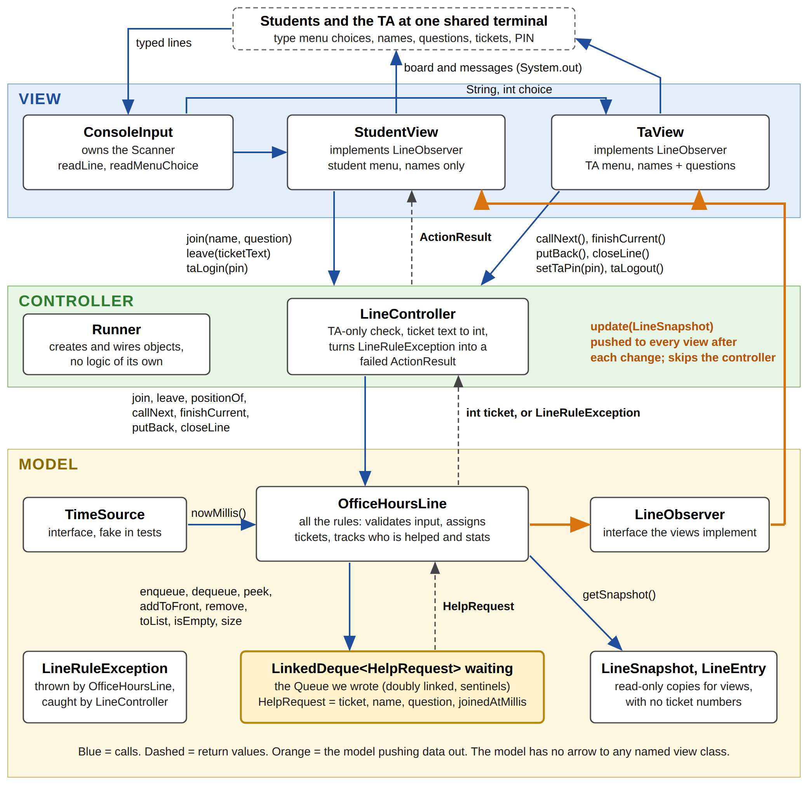

# Next Up

**CS 2114 Project 3, Group 93:** Aditya Banerjee, Nicolas Marchese, Al-Farouq Mohamed, Ha Minh Nguyen

Next Up is a terminal app for running an office-hours line on one shared laptop. Students join with their name and question, and get a private ticket number. They see their place in line and can leave early. The TA logs in with a PIN to call the next student, finish with them, or put them back at the front. When the TA closes the line, it shows how many students were helped and the average wait.

The line is a **queue we wrote ourselves**: `LinkedDeque<T>`, a doubly linked deque with sentinel nodes. The app follows **MVC**. The model (`nextup.model`) knows nothing about the controller or views and tells them about changes only through the `LineObserver` interface.

> **Team: see [TEAM-TODO.md](TEAM-TODO.md) for who does what.** Sections below marked **TODO(name)** are that person's to fill in.



## Project layout

| Package | Classes | Role |
|---|---|---|
| `nextup.model` | `LinkedDeque<T>`, `HelpRequest`, `OfficeHoursLine`, `LineObserver`, `LineSnapshot`, `LineEntry`, `TimeSource`, `LineRuleException` | The line and all its rules. No view, no controller, no `System.out`. |
| `nextup.model` (test helpers) | `FakeTimeSource`, `RecordingObserver` | A clock tests set by hand, and an observer that counts updates. |
| `nextup.controller` | `LineController`, `ActionResult`, `Runner` | Carries actions to the model, owns TA login, wires the program. |
| `nextup.view` | `StudentView`, `TaView`, `ConsoleInput` | The terminal screens and the program's only `Scanner`. |
| `nextup.demo` | `ModelDemo` | Runs the model alone, with no view. |

## How to run

**Setup:** import this folder into Eclipse as an existing project. `CS2-Support` must be in the workspace, since it provides `student.TestCase` and JUnit.

### The model, with no view

- **Tests:** right-click `src/nextup/model`, then Run As → JUnit Test. `OfficeHoursLineTest`, `ModelTypesTest`, and `LinkedDequeTest` create no view, controller, or `Scanner`. `ModelBoundaryTest` reads the model's source files and fails if any of them imports `nextup.view` or `nextup.controller`, or uses `System.out`.
- **Driver:** run `src/nextup/demo/ModelDemo.java` as a Java Application. It walks the whole MVP path and five bad inputs against the model only, and prints the snapshot the model sends after each change:

```
> Ana, Ben, and Cal join
  now helping: nobody | waiting: 1.Ana(0m) 2.Ben(0m) 3.Cal(0m) | helped 0, avg 0.0 min
> Bad input: " ana " joins again
  refused: You're already in line at #1.
...
> TA closes the line
  now helping: nobody | waiting: | helped 2, avg 3.0 min | CLOSED
```

### The thin view

Run `src/nextup/controller/Runner.java` as a Java Application.

**TODO(Al-Farouq):** once the views work, write the steps here. Include what to type for the TA PIN, joining, TA login, call next, finish, and close.

### From a terminal, without Eclipse

```
cp <workspace>/CS2-Support/student.jar .
javac -d bin -cp student.jar $(find src -name '*.java')
java -cp bin nextup.demo.ModelDemo
java -cp bin nextup.controller.Runner
java -Djava.security.manager=allow -cp bin:student.jar org.junit.runner.JUnitCore \
  nextup.model.LinkedDequeTest nextup.model.OfficeHoursLineTest nextup.model.ModelTypesTest \
  nextup.model.ModelBoundaryTest nextup.controller.LineControllerTest \
  nextup.view.ConsoleInputTest nextup.view.ViewTest
```

(`-Djava.security.manager=allow` is needed only on Java 18 or newer.)

## Reflection

### What changed from our specification

Each change lists what prompted it.

**Model: the line (Aditya)**

| What the D2 spec said | What we built | Why (what prompted it) |
|---|---|---|
| `OfficeHoursLine` picks random tickets with "a `boolean[]` and a retry loop." | Added an `int ticketsIssued` field. When all 9000 tickets are used, `join` throws "No tickets are left this session." | While writing `newTicket()` we saw that the retry loop would spin forever once every ticket was used. One counter makes that impossible. |
| The test plan used a fake `TimeSource` and a `RecordingObserver` but did not list them as classes. | Both are real classes in `nextup.model`: `FakeTimeSource` and `RecordingObserver`. | Both `OfficeHoursLineTest` and `LineControllerTest` need them. Two copies would drift apart. |
| The test plan had a "small model types" table but named no test file for it. | Added `ModelTypesTest`. | D3's attribution needs one row per test file, so each test needs a home. |
| The test plan said "search `nextup.model` to check it does not import `nextup.view`..." | That check is now an automatic test, `ModelBoundaryTest`. | A manual search is easy to forget. As a test, it runs every time and names the file that broke the rule. |
| D3 asks for "a tiny driver or a test." | Added `ModelDemo` in its own package, `nextup.demo`. | It prints, and our own rule is that nothing in `nextup.model` uses `System.out`. A separate package keeps that rule true. |
| `join` rules were listed but not their order, and some messages were "a matching message." | The order is: closed, blank, too long, already being helped, already waiting, full. The new messages are "Question can't be blank.", "You're being helped right now.", "The line is closed.", and "The line is already closed." | A test of a student who is already in line *and* hits a full line showed that "The line is full." is the less useful answer. Saying where they are comes first. |
| `LineEntry.minutesWaited` for the student being helped was not defined. | For position 0, it is the wait from join to being called, which stops growing once they're called. | That matches what `finishCurrent` adds to the stats, so the number on screen equals the number in the average. |
| `HelpRequest` checked tickets "1000-9999." | Added public constants `HelpRequest.MIN_TICKET` and `MAX_TICKET`, and `OfficeHoursLine` uses them. | The range was written in two classes. Now it lives in one place. |

**Model: the Queue.** **TODO(Nicolas):** did `LinkedDeque` match the D2 signatures? Note anything you changed and why, or say "built as specified."

**Controller.** **TODO(Ha Minh):** anything that differed from the spec, and why.

**Views.** **TODO(Al-Farouq):** anything that differed from the spec, and why. One decision is already made in the skeleton, though the spec didn't settle it: `readMenuChoice` returns `-1` when input ends (Ctrl+D), so `run()` can stop cleanly.

### Did the model really stand alone?

Yes. `OfficeHoursLineTest` (19 tests) and `ModelTypesTest` (8 tests) run with no view, controller, or `Scanner`. `ModelDemo` drives the full MVP path the same way. `ModelBoundaryTest` checks the source and confirms that no model file imports `nextup.view` or `nextup.controller`, or prints. Nothing had to move across the model/view line to make the model run.

The one dependency we felt was *inside* the model: `OfficeHoursLine` cannot run until `LinkedDeque` works, so its tests stayed red until the Queue was merged. **TODO(team):** confirm this is still true after the controller and views are merged. For example, did any view need something from the model that isn't in `LineSnapshot`?

### What happened to our unknowns

These are the five unknowns from our Deliverable 1 scope:

| Unknown (D1) | Status |
|---|---|
| How does a view find out the line changed without the model knowing it exists? | **Figured out.** The Observer pattern from the Week 10 Counter example. `OfficeHoursLine` calls `LineObserver.update(LineSnapshot)` after every change, and both views implement it. |
| How do we unit test wait times that depend on the clock? | **Figured out.** The model asks a `TimeSource` for the time. Tests pass `FakeTimeSource` and set it by hand, so "waited 3 minutes" takes no real time. |
| Should the deque be generic, and which operations do we need? | **Figured out.** It's generic `LinkedDeque<T>`, with `addToFront` (put back), `remove` (leaving early), `toList` (snapshots), and `size`, on top of the core four. |
| How do we make tickets unique but not guessable? | **Figured out.** Tickets are random numbers from 1000 to 9999. A `boolean[]` makes sure none is ever reused, and `LineEntry` has no ticket field, so no screen can show someone else's. |
| Can a terminal `Scanner` loop and a Swing window run at the same time, and on which thread? | **Still open.** Only the Swing-board stretch goal needs it, and the MVP doesn't. |

### What doesn't work yet

**TODO(Ha Minh, after the first full run on Wed Nov 11):** list any MVP features, bad-input cases from the D2 validation table, or tests that are missing or failing. If everything works, say so and list what was tested.

## Next Steps

*Draft by Aditya. **TODO(team):** check this on Thu Nov 12 and fix it to match what actually got built.*

### 1. Finish the MVP (in order)

| # | Item | Owner |
|---|---|---|
| 1 | Fix anything the first full run found (see "What doesn't work yet") | Owner of the broken class |
| 2 | Make sure every bad-input case in the D2 validation table survives in `Runner`, not only in tests | Ha Minh |
| 3 | Clean up the screens: one blank line between redraws, and stats printed on close | Al-Farouq |

### 2. Our change feature: wait-time estimates

Each waiting student sees an estimate of how long until they're called. The estimate is their position times the average length of recent help sessions (the time from `callNext` to `finishCurrent`). This **adds model state and logic**: the model currently tracks waits (join to called), but not how long helping takes. A user reaches it through the controller and views, because it shows up on both screens. It was one of our D1 stretch goals.

**Our prediction, by method:**

| Class | Will change? | Exactly what |
|---|---|---|
| `OfficeHoursLine` | **Yes** | A new field `long totalHelpMillis`. `finishCurrent()` adds `now - calledAtMillis` to it (only finished students count, not put-backs). A new private `int estimateMinutes(int position)` returns `position × totalHelpMillis / helpedCount`, rounded up to minutes, or `-1` when nobody has been helped yet. `getSnapshot()` passes it into each `LineEntry`. |
| `LineEntry` | **Yes** | A new field `estimatedWaitMinutes`, a new constructor parameter, and a new getter `getEstimatedWaitMinutes()`. |
| `StudentView`, `TaView` | **Yes** | The code that draws the line prints "about 6 min" next to each name, or "estimate after first student" when the estimate is `-1`. |
| `LineSnapshot` | No | It already carries a list of `LineEntry`, so the new field rides along. |
| `LineController`, `ActionResult` | No | The estimate is data that flows out through the snapshot. No new action goes in. |
| `LinkedDeque`, `HelpRequest`, `LineObserver`, `TimeSource`, `ConsoleInput`, `Runner` | No | The Queue, the request, the observer contract, and input don't care about estimates. |

If this holds, the feature touches the model and the views but **no controller code and not the Queue**. That is what our model/view line should give us. In Deliverable 4 we will compare this table to what actually changed.

### 3. Stretch goals

| Stretch goal (D1) | Decision |
|---|---|
| Wait-time estimates | **Committed.** It's our change feature. |
| Live "Now Helping" Swing board | **TODO(team): decide.** A second view would show off the Observer design, but our unknown about running Swing and a `Scanner` together is still open. |
| Two TAs, one line | **Dropped.** It would rework `nowHelping` into a list and every TA command. That's too big alongside the change feature. |
| Save and restore the line | **Dropped.** File I/O adds error cases that have nothing to do with the Queue. |

### 4. New tests needed

| Test | Cases | Owner |
|---|---|---|
| `OfficeHoursLineTest` | No estimate (`-1`) before anyone is helped. After helping two students for 4 and 6 minutes, position 3 shows 15. A put-back doesn't count as a help session. Estimates update after `leave`. | Aditya |
| `ModelTypesTest` | `LineEntry` with estimate `-1` is allowed; `-2` throws `IllegalArgumentException`. | Aditya |
| `ViewTest` | StudentView prints the estimate, and prints the "after first student" text when it's `-1`. | Al-Farouq |
| `LineControllerTest` | No new cases. This confirms the prediction that the controller doesn't change. | Ha Minh |
| `LinkedDequeTest` | No new cases. | Nicolas |

### 5. Who does what for D4

| Item | Owner |
|---|---|
| Model changes for estimates and their tests | Aditya |
| View changes for estimates and their tests | Al-Farouq |
| Confirm the controller needed no change, and update the system diagram | Ha Minh |
| Compare the prediction to what actually changed (D4 write-up) | Nicolas |

## Attribution

One row per class and test file. "How" means wrote, revised, reviewed, tested, or GenAI-assisted.

| File | Who | How |
|---|---|---|
| `model/LinkedDeque.java` | Nicolas Marchese | **TODO(Nicolas)**. Skeleton (signatures and Javadoc) generated by Aditya with Claude from our D2 spec. |
| `model/LinkedDequeTest.java` | Nicolas Marchese | **TODO(Nicolas)**. Test names and cases from our D2 test plan, laid out by Aditya with Claude. |
| `model/OfficeHoursLine.java` | Aditya Banerjee | Written with GenAI (Claude) from our D2 spec; reviewed and tested by Aditya. |
| `model/HelpRequest.java` | Aditya Banerjee | Written with GenAI (Claude) from our D2 spec; reviewed and tested by Aditya. |
| `model/LineEntry.java` | Aditya Banerjee | Written with GenAI (Claude) from our D2 spec; reviewed and tested by Aditya. |
| `model/LineSnapshot.java` | Aditya Banerjee | Written with GenAI (Claude) from our D2 spec; reviewed and tested by Aditya. |
| `model/LineObserver.java` | Aditya Banerjee | Written with GenAI (Claude) from our D2 spec; reviewed by Aditya. |
| `model/TimeSource.java` | Aditya Banerjee | Written with GenAI (Claude) from our D2 spec; reviewed by Aditya. |
| `model/LineRuleException.java` | Aditya Banerjee | Written with GenAI (Claude) from our D2 spec; reviewed and tested by Aditya. |
| `model/FakeTimeSource.java` | Aditya Banerjee | Test helper written with GenAI (Claude); reviewed by Aditya. |
| `model/RecordingObserver.java` | Aditya Banerjee | Test helper written with GenAI (Claude); reviewed by Aditya. |
| `model/OfficeHoursLineTest.java` | Aditya Banerjee | Written with GenAI (Claude) from our D2 test plan; reviewed and run by Aditya. |
| `model/ModelTypesTest.java` | Aditya Banerjee | Written with GenAI (Claude) from our D2 test plan; reviewed and run by Aditya. |
| `model/ModelBoundaryTest.java` | Aditya Banerjee | Written with GenAI (Claude) from our D2 test plan; reviewed and run by Aditya. |
| `demo/ModelDemo.java` | Aditya Banerjee | Written with GenAI (Claude); reviewed and run by Aditya. |
| `controller/ActionResult.java` | Ha Minh Nguyen | **TODO(Ha Minh)**. Skeleton generated by Aditya with Claude from our D2 spec. |
| `controller/LineController.java` | Ha Minh Nguyen | **TODO(Ha Minh)**. Skeleton generated by Aditya with Claude from our D2 spec. |
| `controller/Runner.java` | Ha Minh Nguyen | **TODO(Ha Minh)**. Skeleton generated by Aditya with Claude from our D2 spec. |
| `controller/LineControllerTest.java` | Ha Minh Nguyen | **TODO(Ha Minh)**. Test names and cases laid out by Aditya with Claude. |
| `view/ConsoleInput.java` | Al-Farouq Mohamed | **TODO(Al-Farouq)**. Skeleton generated by Aditya with Claude from our D2 spec. |
| `view/StudentView.java` | Al-Farouq Mohamed | **TODO(Al-Farouq)**. Skeleton generated by Aditya with Claude from our D2 spec. |
| `view/TaView.java` | Al-Farouq Mohamed | **TODO(Al-Farouq)**. Skeleton generated by Aditya with Claude from our D2 spec. |
| `view/ConsoleInputTest.java` | Al-Farouq Mohamed | **TODO(Al-Farouq)**. Test names and cases laid out by Aditya with Claude. |
| `view/ViewTest.java` | Al-Farouq Mohamed | **TODO(Al-Farouq)**. Test names and cases laid out by Aditya with Claude. |

## GenAI note

Aditya used Claude Code (Anthropic) to set up this repository. It was given our D2 specification and test plan and the D3 instructions and rubric. It generated the skeleton of every class (packages, signatures, Javadoc, and TODO steps) and the test method names and cases for each test file. It then wrote the line half of the model: `OfficeHoursLine`, the small model types, the two test helpers, `ModelDemo`, and the model tests. Aditya reviewed that code and ran the tests; all 28 pass.

Following the D3 tip, Aditya described our classes to Claude and asked which ones wait-time estimates would force us to edit. Its list was `OfficeHoursLine`, `LineEntry`, and both views, with no controller changes. That list stays on the correct sides of our model/view line, so we kept the feature. Claude's list is the prediction table in Next Steps.

**TODO(Nicolas, Ha Minh, Al-Farouq):** one or two sentences each. Did you use GenAI for your part? If so, what did you ask, and what did you keep or change?
